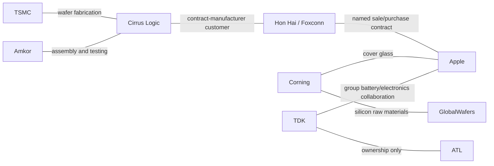

# Apple manufacturing: documented stages and the remaining gaps

Issued 25 October 2026 · Evidence cutoff 24 October 2026 · Batch `apple-manufacturing-20261024-v1` · Base revision 1

This batch expands Apple’s network beyond chips into glass, displays, cameras, batteries, acoustics, circuit boards, assembly and manufacturing ownership. It adds **21 company/legal-entity records, 67 relationship records, 75 atomic claims and one project**. The resulting register contains **135 companies and 247 relationships**. These are evidence records, not independent supplier exposures or demonstrated stock-price transmission. No return or trading experiment was run.

## What went into the research

The root review covered Apple’s FY2023, FY2024 and FY2025 annual reports and its two latest available interim filings at the cutoff. It enumerated all **187 unique names** in Apple’s FY2023 supplier list, then investigated a bounded selection of **25 companies including Apple**, with at most two additional company hops. Three private legal entities were enumerated for ownership context without investigating their wider ecosystems.

- [Apple / SEC: 2023-11-02](https://www.sec.gov/Archives/edgar/data/320193/000032019323000106/aapl-20230930.htm)
- [Apple / SEC: 2024-11-01](https://www.sec.gov/Archives/edgar/data/320193/000032019324000123/aapl-20240928.htm)
- [Apple / SEC: 2025-10-31](https://www.sec.gov/Archives/edgar/data/320193/000032019325000079/aapl-20250927.htm)
- [Apple Inc. / SEC EDGAR: 2026-05-01](https://www.sec.gov/Archives/edgar/data/320193/000032019326000013/aapl-20260328.htm)
- [Apple / SEC: 2026-07-31](https://www.sec.gov/Archives/edgar/data/320193/000032019326000020/aapl-20260627.htm)

The [official supplier list](https://www.supplychainreports.apple/Apple-Supplier-List) covers FY2023, not a current 2026 roster. Its stated spend coverage is not a measure of bill-of-materials completeness. **37 list names are resolved; 150 remain queued.** The complete extraction preserves names and page locators. Product catalogues were never used to assign components to Apple.

Counterparty review covered relevant sections of 19 latest annual reports directly and the latest consolidated parent report for private Tata Electronics. Full annual reviews for LG Innotek, Desay and Simplo remain pending; the Zhen Ding annual download was blocked. The source and coverage registers distinguish these outcomes. Reviewing selected sections does not complete a company’s ecosystem.

## Documented manufacturing stages

| Stage | Companies and retained evidence | What remains unknown |
|---|---|---|
| Glass | Corning: named cover-glass/Ceramic Shield collaboration; Apple manufacturing commitment. [Corning Incorporated / SEC EDGAR: 2026-02-12](https://www.sec.gov/Archives/edgar/data/24741/000002474126000124/glw-20251231.htm); [Apple: 2025-08-06](https://www.apple.com/newsroom/2025/08/apple-corning-to-manufacture-all-iphone-apple-watch-cover-glass-in-kentucky/) | Model allocation and deployed amount of the new commitment. |
| Image sensors | Sony group: Apple’s 2022 camera-sensor disclosure. [Apple Inc.: 2022-12-13](https://www.apple.com/jp/newsroom/2022/12/apple-accelerates-investment-with-suppliers-in-japan/) | Exact contracting subsidiary and all current-generation allocations. |
| Displays | LG Display and BOE: attributed 2025 iPhone model mapping. [CMB International Global Markets: 2025-09-10](https://hk-official.cmbi.info/upload/8f468b33-27b1-4911-9dda-f8e21c250676.pdf) | Named bilateral purchaser, volumes and 2026 continuity. |
| Camera modules and lenses | LG Innotek and Largan: attributed 2025 mapping; a 2016 court opinion separately establishes historical Largan component presence. [CMB International Global Markets: 2025-09-10](https://hk-official.cmbi.info/upload/8f468b33-27b1-4911-9dda-f8e21c250676.pdf); [U.S. Court of Appeals for the Federal Circuit: 2016-04-27](https://www.cafc.uscourts.gov/opinions-orders/15-1695.opinion.4-25-2016.1.pdf) | Named module/system integrators in the historical route. |
| Acoustics, haptics and thermal | AAC: attributed 2025 mapping. Goertek has generic list membership only. [CMB International Global Markets: 2025-09-10](https://hk-official.cmbi.info/upload/8f468b33-27b1-4911-9dda-f8e21c250676.pdf); [Apple Inc.: publication date unresolved](https://www.supplychainreports.apple/Apple-Supplier-List) | Verified Goertek product assignment; current AAC allocations. |
| Batteries and other electronics | TDK: primary 2026 collaboration; Sunwoda: primary 2017 battery role. Desay and Simplo: attributed 2025 mapping. [TDK Corporation: 2026-03-27](https://www.tdk.com/en/news_center/press/20260327_01.html); [Apple Inc.: 2017-10](https://images.apple.com/environment/pdf/Apple_Supplier_Clean_Energy_Program_Update_October_2017.pdf); [CMB International Global Markets: 2025-09-10](https://hk-official.cmbi.info/upload/8f468b33-27b1-4911-9dda-f8e21c250676.pdf) | Exact cells, pack integrators, facilities, models and current shares. |
| Circuit boards | Zhen Ding: attributed iPhone 16 PCB exposure in 2024. [KGI Asia: 2024-09-13](https://www.kgi.com.hk/en/-/media/files/kgishk/research-reports/tw-reports/2024/01/apple-supply-chain_13092024.pdf) | Current allocations and purchaser route. |
| Assembly | Hon Hai: a named Apple sale/purchase contract in its latest annual report. Luxshare AirPods and Hon Hai/Compal Watch roles: attributed 2024 mapping. [Hon Hai Precision Industry: publication date unresolved](https://image.honhai.com/upload/202605/financy_by_year/2025_Annual_Report_20260523_7728.pdf); [KGI Asia: 2024-09-13](https://www.kgi.com.hk/en/-/media/files/kgishk/research-reports/tw-reports/2024/01/apple-supply-chain_13092024.pdf) | Model-level 2026 allocation and subcontractor routes. |
| Second-tier manufacturing | TSMC and Amkor explicitly named by Cirrus as foundry and assembly/test providers. [Cirrus Logic / SEC: 2026-05-21](https://www.sec.gov/Archives/edgar/data/772406/000077240626000018/crus-20260328.htm) | Which output ultimately serves Apple. |
| Upstream materials | Corning silicon raw materials for GlobalWafers, explicitly named by Apple. [Apple: 2025-08-06](https://www.apple.com/newsroom/2025/08/apple-corning-to-manufacture-all-iphone-apple-watch-cover-glass-in-kentucky/) | Shipment-level destination and customer concentration. |

Primary and institutional evidence stay separate. CMB International’s 10 September 2025 model mapping is an attributed view of those products; KGI’s 13 September 2024 mapping is a different dated view. Neither establishes a 2026 allocation. CMB’s AAC Apple sales estimate of 30% for 2025E remains a forecast. AAC’s anonymous largest customer is not identified as Apple.

## Connected paths without invented shortcuts

Each segment has its own claim. The path does not establish that a particular TSMC wafer passes through Cirrus and Foxconn into an Apple device. TDK’s ownership of ATL does not create an ATL–Apple supply contract. Largan’s historically described integration stages remain unnamed; the graph does not fill them with LG Innotek or Hon Hai by inference.

Cirrus reports Foxconn-group contract manufacturers at 39% of gross trade receivables on 28 March 2026. This is neither sales concentration nor Apple-specific volume. An older Luxsan/Luxshare name issue remains an identity lead; the 22% measure is not assigned to listed Luxshare. [Cirrus Logic / SEC: 2026-05-21](https://www.sec.gov/Archives/edgar/data/772406/000077240626000018/crus-20260328.htm)

## Ownership and operational changes matter

- Tata Electronics’ 60% acquisition of Pegatron Technology India and Pegatron’s subsequently reported 40% interest attach to one renamed India entity, Tata Electronics Products and Solutions. They do not represent an acquisition of the listed Pegatron parent. [Tata Electronics: 2025-01-24](https://www.tataelectronics.com/w/tata-electronics-announces-acquisition-of-majority-stake-in-pegatron-technology-india); [Pegatron Corporation: publication date unresolved](https://www.pegatroncorp.com/media/20260508074846949_2025_Annual_Report_Eng.pdf)
- BYD Company and BYD Electronic remain separate listed issuers. The latter’s report discloses indirect BYD control of 65.76% at year-end 2025. Jabil’s USD2.2bn Mobility disposal is a business-asset transaction with the BYD Electronic group; no Apple-contract transfer is inferred. [BYD Electronic / HKEX: 2026-04-22](https://www1.hkexnews.hk/listedco/listconews/sehk/2026/0422/2026042200748.pdf); [Jabil Inc.: 2023-12-29](https://investors.jabil.com/news/news-details/2023/Jabil-Completes-the-Divestiture-of-Mobility-Business/default.aspx)
- Wistron’s FY2025 business review says its mobile-phone exit was completed in 2025. Its historical Apple supplier membership stays dated; it is not presented as evidence of current iPhone assembly or termination of every Apple relationship. [Wistron Corporation: publication date unresolved](https://www.wistron.com/file/9ecdf53a-9c8a-4df8-aeed-7568724eb956/2025_WistronAnnualReport_EN.pdf)

## One project, distinct financial roles

The Harrodsburg, Kentucky record combines existing Corning glass production with the announced cover-glass expansion and Apple–Corning Innovation Center. Apple’s USD2.5bn manufacturing purchase commitment and Corning’s manufacturing/expansion role are separately sourced participant roles. The project and relationship show the same commitment, which must not be added twice. The source does not identify a loan, equity investment, guarantee or complete deployment of the announced amount. [Apple: 2025-08-06](https://www.apple.com/newsroom/2025/08/apple-corning-to-manufacture-all-iphone-apple-watch-cover-glass-in-kentucky/)

The project view contains these two companies and the one explicitly supported commitment connection. Co-participation creates no extra bilateral financing contracts.

## Dates and admission decisions

- Fiscal periods, contract start dates, report print dates and public-availability dates remain separate. Unknown publication dates are retained and excluded by historical graph filters.
- The supplier-list names “Sony Corporation” and “Broadcom Limited” remain pending where the precise legal-entity route cannot be established. A similar name or shared group does not resolve it.
- Private ATL, Tata Sons, Tata Electronics and the renamed India entity have no own public share quotation. A parent quotation is not substituted.
- LG Innotek’s explicit AOE optical investment/cooperation announcement is a queue lead. Its exact legal identity and listed-parent route still need work; the automotive/XR collaboration is not assigned to Apple.
- Pegasus-like names, anonymous customer concentrations and the sale of a business cannot establish undisclosed contracts. Exclusions and unresolved leads remain in the coverage/frontier records.

## Coverage and next frontier

| Measure | Result |
|---|---|
| Root required reports | 3 annual + 2 interim reviewed |
| Deeper company investigation budget | 25 companies, including Apple |
| Official-list enumeration | 187 / 187 names |
| Resolved / unresolved list names | 37 / 150 |
| New company / relationship / claim records | 21 / 67 / 75 |
| New source records | 37; repeated URLs reuse existing source IDs |
| New project / participation records | 1 / 2 |
| Pending or updated work | 277 frontier additions, 6 record updates |
| Coverage records | 46, including exclusions and gaps |

These figures measure this search process, not the percentage of the true network discovered. Apple’s manufacturing branch stays **in progress**. Other branches for the new companies remain pending.

The next batch should resolve the remaining official-list entities and missing annual filings before extending another two hops. Uncovered manufacturing work includes connectors/passives, mechanics/enclosures, chemicals/coatings, tooling, logistics and verified supplier-to-integrator routes. Project expansion should first resolve actual SPVs, facility status and named financing counterparties. No stock-performance ranking was used to select leads.

## Reproduce and inspect

The release includes the versioned proposal, complete supplier-list extraction, identity decisions, source/claim/relationship registers, document-review records, exclusions, and validation/publication receipts. Raw copyrighted reports remain outside the release; source URLs, hashes where retrieved, and section/page locators support reinspection. Structural validation checks consistency; it does not independently certify factual truth.

Start a fresh app from the frozen seed, then import `research/batches/apple-manufacturing-20261024/batch_v1.json` in Batches, review its diff and publish. The installed app already contains this batch after publication. Export revision 1 to `.test_runs/apple_batch/base_export.json` if regenerating these derived reports. `tools/build_apple_manufacturing_batch.py` rebuilds a proposal from the reviewed evidence records; it does not download sources or publish.

## New company register

| Company | Country | Status | Instrument routing |
|---|---|---|---|
| TDK Corporation (`TDK`) | Japan | public | 6762.T |
| Sunwoda Electronic Co., Ltd. (`SUNWODA`) | China | public | 300207.SZ |
| LG Display Co., Ltd. (`LGDISPLAY`) | South Korea | public | 034220.KS |
| BOE Technology Group Co., Ltd. (`BOE`) | China | public | 000725.SZ |
| Largan Precision Co., Ltd. (`LARGAN`) | Taiwan | public | 3008.TW |
| AAC Technologies Holdings Inc. (`AAC`) | China | public | 2018.HK |
| Goertek Inc. (`GOERTEK`) | China | public | 002241.SZ |
| LG Innotek Co., Ltd. (`LGINNOTEK`) | South Korea | public | Verification pending |
| Shenzhen Desay Battery Technology Co., Ltd. (`DESAYBATTERY`) | China | public | Verification pending |
| Simplo Technology Co., Ltd. (`SIMPLO`) | Taiwan | public | 6121.TWO |
| Amperex Technology Limited (`ATL`) | Hong Kong | private subsidiary | No own public share |
| Pegatron Corporation (`PEGATRON`) | Taiwan | public | Verification pending |
| Tata Electronics Private Limited (`TATA_ELECTRONICS`) | India | private subsidiary | No own public share |
| Tata Sons Private Limited (`TATA_SONS`) | India | private | No own public share |
| Tata Electronics Products and Solutions Private Limited (`TATA_EPS`) | India | private subsidiary | No own public share |
| Jabil Inc. (`JABIL`) | United States | public | JBL |
| Flex Ltd. (`FLEX`) | Singapore | public | FLEX |
| BYD Company Limited (`BYD`) | China | public | 1211.HK |
| BYD Electronic (International) Company Limited (`BYDELECTRONIC`) | Hong Kong | public | 0285.HK |
| Compal Electronics, Inc. (`COMPAL`) | Taiwan | public | 2324.TW |
| Zhen Ding Technology Holding Limited (`ZHENDING`) | Taiwan | public | 4958.TW |

## New non-list relationship register

The 37 resolved generic supplier-list memberships are in the complete identity register. The following 30 records carry additional, distinct claims. “Known from” is a public-availability bound, not a business start date.

| Record / companies | Claim | Grade / known from | Source |
|---|---|---|---|
| `ACM26_r12`: SONY / AAPL | Apple identifies Sony as the manufacturer of iPhone camera sensors, including the iPhone 14 Pro 48MP sensor. | primary / 2022-12-13 | [Apple Inc.: 2022-12-13](https://www.apple.com/jp/newsroom/2022/12/apple-accelerates-investment-with-suppliers-in-japan/) |
| `ACM26_r13`: GLW / AAPL | Corning identifies collaboration on colored iPhone 15/15 Plus back glass and Ceramic Shield. | primary / 2026-02-12 | [Corning Incorporated / SEC EDGAR: 2026-02-12](https://www.sec.gov/Archives/edgar/data/24741/000002474126000124/glw-20251231.htm) |
| `ACM26_r14`: AAPL / GLW | Apple commits $2.5 billion toward Corning cover-glass manufacturing in Harrodsburg, Kentucky. | primary / 2025-08-06 | [Apple: 2025-08-06](https://www.apple.com/newsroom/2025/08/apple-corning-to-manufacture-all-iphone-apple-watch-cover-glass-in-kentucky/) |
| `ACM26_r15`: TDK / AAPL | TDK confirms collaboration with Apple on rechargeable batteries and electronic components. | primary / 2026-03-27 | [TDK Corporation: 2026-03-27](https://www.tdk.com/en/news_center/press/20260327_01.html) |
| `ACM26_r16`: TDK / AAPL | TDK plans US production of advanced sensors for Apple products. | primary / 2026-03-27 | [TDK Corporation: 2026-03-27](https://www.tdk.com/en/news_center/press/20260327_01.html) |
| `ACM26_r17`: SUNWODA / AAPL | Apple explicitly identifies Sunwoda as a battery supplier. | primary / 2017-10-31 | [Apple Inc.: 2017-10](https://images.apple.com/environment/pdf/Apple_Supplier_Clean_Energy_Program_Update_October_2017.pdf) |
| `ACM26_r18`: LGDISPLAY / AAPL | Reported iPhone 16/17 display provider. | attributed / 2025-09-10 | [CMB International Global Markets: 2025-09-10](https://hk-official.cmbi.info/upload/8f468b33-27b1-4911-9dda-f8e21c250676.pdf) |
| `ACM26_r19`: BOE / AAPL | Reported iPhone 16/17 display provider. | attributed / 2025-09-10 | [CMB International Global Markets: 2025-09-10](https://hk-official.cmbi.info/upload/8f468b33-27b1-4911-9dda-f8e21c250676.pdf) |
| `ACM26_r20`: LGINNOTEK / AAPL | Reported iPhone 16/17 camera module provider. | attributed / 2025-09-10 | [CMB International Global Markets: 2025-09-10](https://hk-official.cmbi.info/upload/8f468b33-27b1-4911-9dda-f8e21c250676.pdf) |
| `ACM26_r21`: LARGAN / AAPL | Reported iPhone 16/17 lens provider. | attributed / 2025-09-10 | [CMB International Global Markets: 2025-09-10](https://hk-official.cmbi.info/upload/8f468b33-27b1-4911-9dda-f8e21c250676.pdf) |
| `ACM26_r22`: AAC / AAPL | Reported iPhone 16/17 acoustic/haptic/thermal provider. | attributed / 2025-09-10 | [CMB International Global Markets: 2025-09-10](https://hk-official.cmbi.info/upload/8f468b33-27b1-4911-9dda-f8e21c250676.pdf) |
| `ACM26_r23`: DESAYBATTERY / AAPL | Reported iPhone 16/17 battery provider. | attributed / 2025-09-10 | [CMB International Global Markets: 2025-09-10](https://hk-official.cmbi.info/upload/8f468b33-27b1-4911-9dda-f8e21c250676.pdf) |
| `ACM26_r24`: SIMPLO / AAPL | Reported iPhone 16/17 battery provider. | attributed / 2025-09-10 | [CMB International Global Markets: 2025-09-10](https://hk-official.cmbi.info/upload/8f468b33-27b1-4911-9dda-f8e21c250676.pdf) |
| `ACM26_r25`: AAC / AAPL | Estimated Apple sales mix: 30% (2025E). | attributed / 2025-09-10 | [CMB International Global Markets: 2025-09-10](https://hk-official.cmbi.info/upload/8f468b33-27b1-4911-9dda-f8e21c250676.pdf) |
| `ACM26_r26`: LARGAN / AAPL | The court describes Largan lenses in Apple phones/tablets through unnamed integration stages. | primary / 2016-04-27 | [U.S. Court of Appeals for the Federal Circuit: 2016-04-27](https://www.cafc.uscourts.gov/opinions-orders/15-1695.opinion.4-25-2016.1.pdf) |
| `ACM26_r27`: TDK / ATL | TDK reports 100% voting ownership of Amperex Technology Limited, including indirect holdings. | primary / 2026-06-17 | [TDK Corporation: 2026-06-17](https://www.tdk.com/system/files/ir_library_report_pdf_T130_ja.pdf) |
| `AAM26_r12`: FOXCONN / AAPL | Hon Hai lists its Apple sale-and-purchase contract, effective from December 7, 1999 until termination. | primary / unknown | [Hon Hai Precision Industry: publication date unresolved](https://image.honhai.com/upload/202605/financy_by_year/2025_Annual_Report_20260523_7728.pdf) |
| `AAM26_r13`: LUXSHARE / AAPL | KGI attributes AirPods assembly exposure to the named company in September 2024. | attributed / 2024-09-13 | [KGI Asia: 2024-09-13](https://www.kgi.com.hk/en/-/media/files/kgishk/research-reports/tw-reports/2024/01/apple-supply-chain_13092024.pdf) |
| `AAM26_r14`: FOXCONN / AAPL | KGI attributes Apple Watch assembly exposure to the named company in September 2024. | attributed / 2024-09-13 | [KGI Asia: 2024-09-13](https://www.kgi.com.hk/en/-/media/files/kgishk/research-reports/tw-reports/2024/01/apple-supply-chain_13092024.pdf) |
| `AAM26_r15`: COMPAL / AAPL | KGI attributes Apple Watch assembly exposure to the named company in September 2024. | attributed / 2024-09-13 | [KGI Asia: 2024-09-13](https://www.kgi.com.hk/en/-/media/files/kgishk/research-reports/tw-reports/2024/01/apple-supply-chain_13092024.pdf) |
| `AAM26_r16`: ZHENDING / AAPL | KGI attributes iPhone 16 printed circuit boards exposure to the named company in September 2024. | attributed / 2024-09-13 | [KGI Asia: 2024-09-13](https://www.kgi.com.hk/en/-/media/files/kgishk/research-reports/tw-reports/2024/01/apple-supply-chain_13092024.pdf) |
| `AAM26_r17`: BYDELECTRONIC / JABIL | Jabil completed the sale of its Mobility business to the BYD Electronic group for approximately USD 2.2 billion. | primary / 2023-12-29 | [Jabil Inc.: 2023-12-29](https://investors.jabil.com/news/news-details/2023/Jabil-Completes-the-Divestiture-of-Mobility-Business/default.aspx) |
| `AAM26_r18`: BYD / BYDELECTRONIC | BYD Electronic discloses BYD Company indirect control of 65.76% of issued shares. | primary / 2026-04-22 | [BYD Electronic / HKEX: 2026-04-22](https://www1.hkexnews.hk/listedco/listconews/sehk/2026/0422/2026042200748.pdf) |
| `AAM26_r19`: TATA_ELECTRONICS / TATA_EPS | Tata Electronics announced acquisition of a controlling 60% stake in Pegatron Technology India. | primary / 2025-01-24 | [Tata Electronics: 2025-01-24](https://www.tataelectronics.com/w/tata-electronics-announces-acquisition-of-majority-stake-in-pegatron-technology-india) |
| `AAM26_r20`: PEGATRON / TATA_EPS | Pegatron reports 40% total investment ownership in Tata Electronics Products and Solutions. | primary / unknown | [Pegatron Corporation: publication date unresolved](https://www.pegatroncorp.com/media/20260508074846949_2025_Annual_Report_Eng.pdf) |
| `AAM26_r21`: TATA_SONS / TATA_ELECTRONICS | Tata Sons lists Tata Electronics as a wholly controlled consolidated subsidiary. | primary / unknown | [Tata Sons Private Limited: publication date unresolved](https://www.tata.com/content/dam/tata/pdf/fy26/Tata-Sons-Annual-Report-FY26v1.pdf) |
| `AAM26_r22`: CRUS / FOXCONN | Cirrus identifies Foxconn-group contract manufacturers as customers with 39% of gross trade receivables. | primary / 2026-05-21 | [Cirrus Logic / SEC: 2026-05-21](https://www.sec.gov/Archives/edgar/data/772406/000077240626000018/crus-20260328.htm) |
| `AAM26_r23`: TSMC / CRUS | Cirrus names TSMC among its principal wafer foundries. | primary / 2026-05-21 | [Cirrus Logic / SEC: 2026-05-21](https://www.sec.gov/Archives/edgar/data/772406/000077240626000018/crus-20260328.htm) |
| `AAM26_r24`: AMKR / CRUS | Cirrus names Amkor among its primary assembly and test houses. | primary / 2026-05-21 | [Cirrus Logic / SEC: 2026-05-21](https://www.sec.gov/Archives/edgar/data/772406/000077240626000018/crus-20260328.htm) |
| `ARM26_r_glw_globalwafers`: GLW / GLOBALWAFERS | Apple identifies Corning silicon raw materials used by GlobalWafers for planned U.S. bare-wafer production. | primary / 2025-08-06 | [Apple: 2025-08-06](https://www.apple.com/newsroom/2025/08/apple-corning-to-manufacture-all-iphone-apple-watch-cover-glass-in-kentucky/) |
